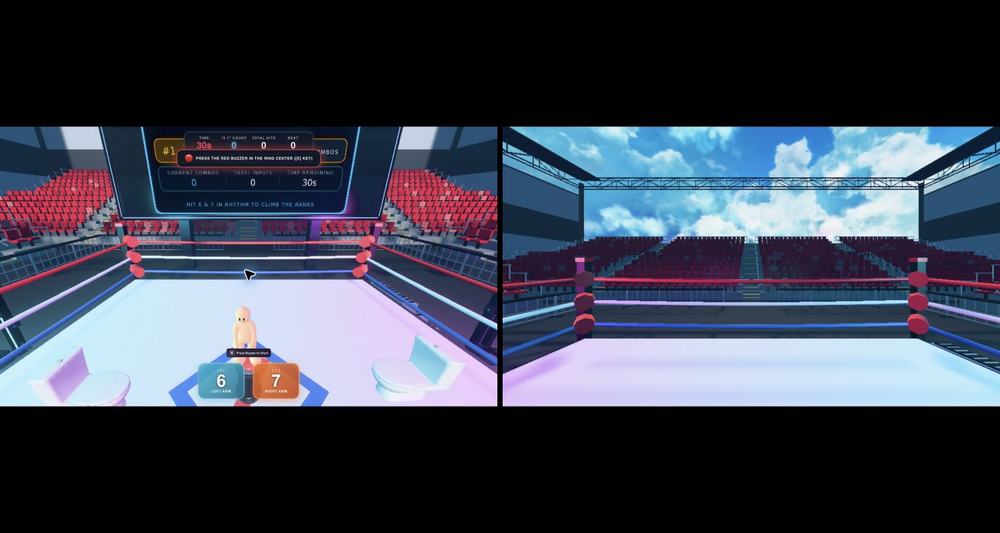

# Arcade VR proxy

Bring existing Arcade games into headset VR while preserving their original game and frontend. Desktop automatically provides a split preview. All production code is TypeScript; no Python or Three.js rewrite is required.


[Architecture](docs/ARCHITECTURE.md) · [Hackathon brief](docs/HACKATHON.md) · [Compatibility](docs/COMPATIBILITY.md) · [Optional branches](docs/REVIEW.md) · [Deployment](docs/DEPLOYMENT.md)

The original Arcade site is served through a fixed-host TypeScript proxy. Paths and query strings stay intact. Editor `/play/<uuid>` and `/mp` routes open a minimal player wrapper; its isolated runtime keeps Arcade's game and UI.

| Original | Proxy |
| --- | --- |
| www.tryarcade.com | www.tryarcade.danielbacsur.dev |
| editor.joinarcade.ai | editor.joinarcade.danielbacsur.dev |
| dashboard.joinarcade.ai | dashboard.joinarcade.danielbacsur.dev |

The runtime, API and storage use `runtime.joinarcade`, `api.joinarcade` and `storage.joinarcade` under the same domain. Unknown hosts and arbitrary asset destinations are rejected.

## Develop

Use Node 22.13 or newer. Python is unnecessary.

```sh
npm ci
npm run check
npm run dev
```

Open `http://localhost:8765`. Editor URLs use `http://editor.joinarcade.localhost:8765` with the original path and query. The server serves the latest build; rebuild after editing browser adapters. `npm start` runs the compiled server.

`npm run check` runs strict TypeScript, ESLint, integration tests and the production build. Dependencies and the lockfile are tracked; generated output, local credentials and diagnostic captures are ignored.

## Player

Desktop has matching 16:9 live and head views with controls below. Both use a 1280 × 720 layout while the scene's render budget is adjustable independently. Head-view dragging controls the character's look; movement follows its heading. Connection is automatic. Mode selection detects immersive WebXR support without a manual override.

Arcade requires WebGPU. Keep it enabled even on browsers without `XRGPUBinding`. Immersive rendering uses native per-eye projection, a stable root anchor, direct look and hand IK. Original menus and HUD follow the view and support hand pointing, pinch selection and held dragging. Movement needs no visible joystick: hold your left hand open in front of your chest, then briefly hold a thumb/index pinch and move that hand to steer; release to stop. Right-hand index pinch handles menus. The browser consent request reuses a native game interaction, with no extra Enter VR button. Details are in [the architecture](docs/ARCHITECTURE.md). Hardware performance and comfort require a real headset; simulated checks are not hardware verification.

## Deploy

Vercel builds `api/index.ts` and the browser adapters. Attach all listed hostnames plus runtime, API and storage to the same project. WebSockets require Vercel Fluid Compute's native WebSocket support, currently public beta, or an ordinary Node server. Long-lived multiplayer connections must reconnect when the platform's function duration expires. The game's protocol owns reconnection; input packets are never replayed by the proxy.

Binary assets and event streams are forwarded without buffering the entire response. Signed query strings and Range requests are preserved. Failed safe reads receive bounded retries; writes are never automatically replayed. Cookies and origin headers are translated only within the known Arcade host family. Vercel platform credentials are removed before upstream requests.

No proxy can guarantee private, deleted, expired or broken upstream games. Compatibility reports must separate proxy failures from upstream and authentication failures. Nothing from the current delivery is pushed or published before review.

## Delivery status

The cleaned main application passes strict types, lint, tests and builds. A live sweep covered 121 public games and 352 bootstrap/asset checks with no proxy discrepancies. Five features have now been merged into main, independently checked and tested together: spatial editor, comfort controls, adaptive quality, haptics/actions and visible hands. See [integrated feature instructions](docs/REVIEW.md) and [the completed delivery record](docs/TODO.md).



HTTP/bootstrap coverage is not a guarantee that every dynamic game, private asset or expired room works. No Quest was available overnight, so device comfort, frame rate and hand accuracy are hardware-unverified. The current work is local and committed; nothing has been pushed or deployed.
