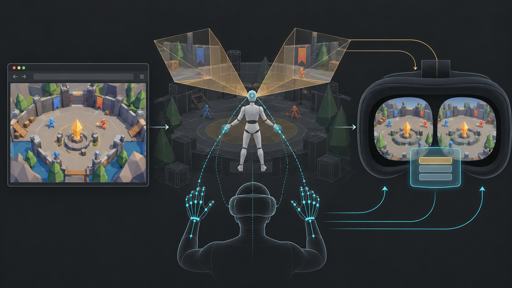
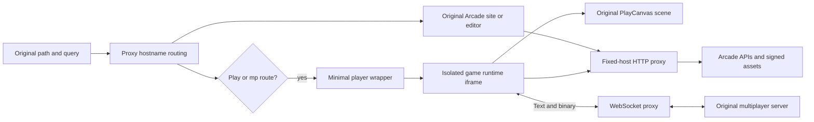
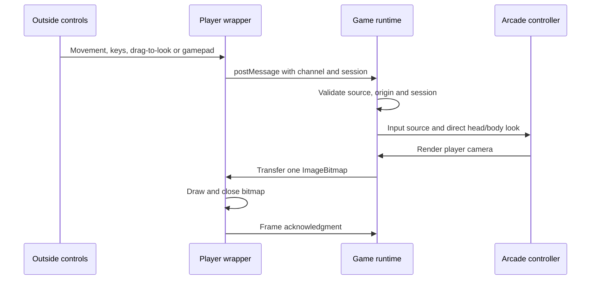
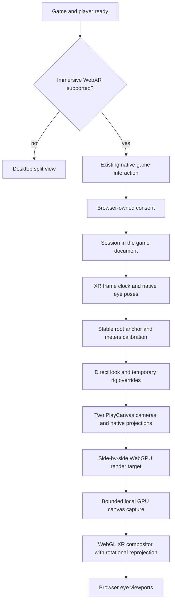
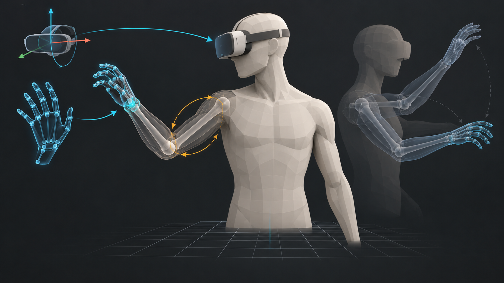
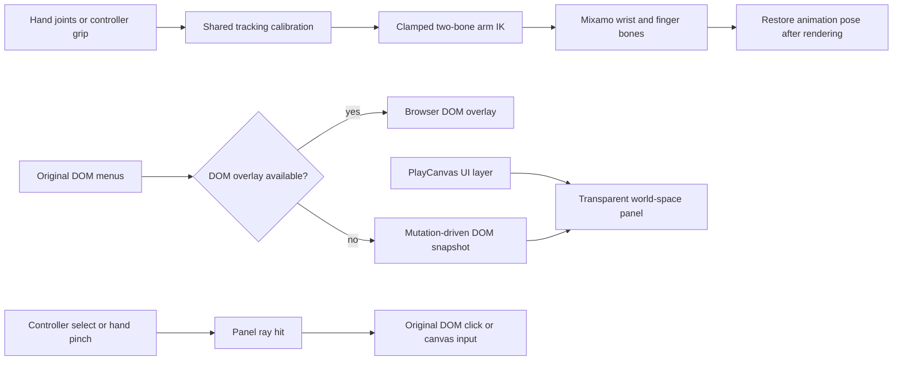

# How the adapter works

Arcade's game engine exposes PlayCanvas through `window.pc` and its game/application services. The adapter uses that existing scene and player controller. It does not rebuild the game in Three.js, stream video from a server, or send headset tracking to the proxy.

*AI-generated conceptual illustration. The diagrams below describe the implemented paths; the illustration is not a device screenshot.*

## Website and network flow

`routing.ts` maps exact known hostnames. `proxy.ts` rewrites upstream origins and injects a small navigation adapter into HTML. The navigation adapter also handles URLs created at runtime, relative requests using `document.baseURI`, popup navigation and WebSocket constructors. Signed query bytes survive unchanged. HTTP matchmaking requests derived from a socket URL use the same host registry.

Binary responses, Range requests and event streams are streamed. Bounded retries apply only to safe reads; writes and game input are never replayed. Vercel platform headers and credentials for unrelated asset destinations are removed. The service is an Arcade-specific proxy, not an arbitrary URL fetcher.

An expired multiplayer join reservation can recover once to a fresh quick match, using a validated public marketplace return link. It preserves the game, not the vanished room or its state. Authorization errors remain authorization errors.

## Desktop data bridge

Both panes retain a 1920 × 1080 document layout and matching aspect ratios. CSS scales the live iframe; rendering resolution changes separately. The desktop head feed defaults to 960 × 540 at up to 30 fps. One pending capture and one unacknowledged frame bound memory and latency. Blurring, hiding or navigating releases controls; stale input times out in the runtime.

## Immersive rendering

The runtime owns the XR session so native game interactions can carry transient activation into `requestSession`. Readiness excludes Arcade's visible asset/world loading progress bar. There is no second Enter VR button. If loading finishes after activation expires, the existing Start/game interaction is still required. Browsers require activation and may show permission UI; automatic consent without any qualifying interaction cannot be guaranteed. [WebXR session rules](https://immersive-web.github.io/webxr/#dom-xrsystem-requestsession).

The engine's ordinary animation loop pauses during XR. Its update/render tick runs from the headset clock. Original gameplay cameras stop rendering; two injected cameras use each eye's actual pose and asymmetric projection. Eye dimensions use a single scale factor and a 2048-pixel per-dimension cap, preserving aspect and IPD. Desktop's 80-degree preview FOV is not used for immersive projection.

The game uses WebGPU. The compositor uses WebGL WebXR without requiring `XRGPUBinding`: a local GPU copy and transferable bitmap bridge connect the two. No CPU pixel array, server round trip, JPEG encoding or frame queue is involved in stereo capture. Texture upload happens only for a new bitmap. Stereo capture preserves encoded sRGB values; UI bitmaps explicitly use straight alpha, preventing a second alpha multiplication in the compositor. This bridge still has completion latency; it is not zero-copy.

Camera position follows the player root plus a once-calibrated eye offset, never the animated Mixamo head. World scale uses head-to-foot standing height separately from that offset, so a capsule-center root does not shrink IPD or misalign the physical floor. Respawning recalibrates the new rig. Reference-space resets recalibrate without accumulating drift. Captured poses travel with each bitmap; the compositor corrects subsequent rotation against the native projection. It does not implement depth-based positional reprojection, so translation during slow capture can still produce latency. Headset comfort and performance need device measurement.

## Hands and menus

*AI-generated conceptual rig illustration; joint mapping and limits are defined by the code and tests.*

Arm IK uses shoulder/elbow/wrist bones, not changes to the game's physics or inventory. Finger joints map when a recognized chain exists. Missing tracking restores the original animation rather than freezing a stale pose. Nonhumanoid rigs remain playable without synthetic bone assumptions. Remote multiplayer hand replication is not implemented; it needs an upstream protocol contract. The [WebXR hand input API](https://immersive-web.github.io/webxr-hand-input/) supplies optional joints; controller grips are the fallback.

Original HTML menus use [DOM overlays](https://immersive-web.github.io/dom-overlays/) when supported. Otherwise a transparent world panel captures DOM changes at up to 4 fps. PlayCanvas's UI layer has its own 1920 × 1080 transparent target at up to 8 fps. A ray hit focuses and clicks the original element, or forwards legacy HUD mouse input. The left secondary button, typically Y, reanchors the panel. Complex cross-origin iframe content, browser-controlled keyboards, tainted canvases and unsupported CSS remain browser constraints.

## Optional modules

`features.ts` supplies typed start/frame/render/eye/select/end hooks. Render-scale and vignette requests are bounded; a failing module is disabled for the session while the base experience continues. The build imports optional modules from `src/features` only on branches containing them. `editor-*` modules attach to editor navigation; other modules attach to game runtimes. Main ships with no optional modules enabled. See [review and merge notes](REVIEW.md).

## Code map

| Responsibility | Source |
| --- | --- |
| Host routing and URL rewriting | `src/server/routing.ts`, `src/client/navigation.ts` |
| Streaming HTTP and socket bridge | `src/server/proxy.ts`, `src/server/websocket.ts` |
| Outside controls and authenticated iframe channel | `src/client/controller.ts`, `src/client/runtime.ts` |
| PlayCanvas camera/input/capture lifecycle | `src/client/engine.ts` |
| XR session, eye compositor and hand sampling | `src/client/xr-presenter.ts` |
| World scale, headings and projection sizing | `src/client/tracking.ts` |
| Rig discovery, IK and pose restoration | `src/client/hands.ts`, `src/client/ik.ts` |
| DOM/HUD capture and ray interaction | `src/client/world-ui.ts`, `src/client/ui-hit.ts` |
| Isolated optional feature hooks | `src/client/features.ts` |
